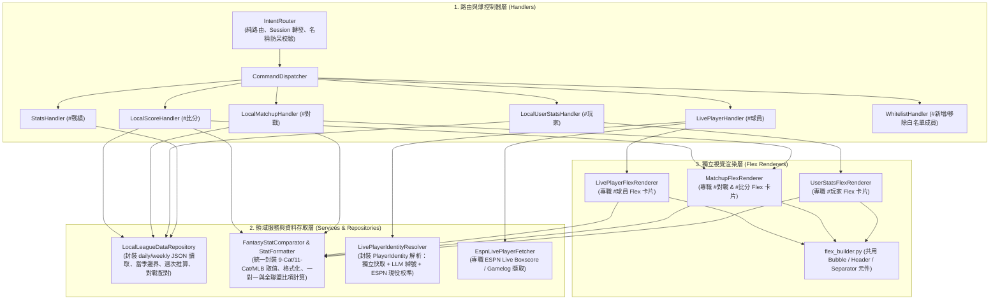

# 專案 OOP 與高耦合架構檢視報告及重構藍圖 (OOP & Decoupling Architecture Review)

**建立日期**：2026-11-24  
**檢視範圍**：本次新增之 `#球員` 即時數據模組，以及前期開發之本地端戰績/對戰/比分/玩家查詢與語意路由模組（`src/handlers/`、`src/visualizer/`、`src/live_api_fetcher.py`、`src/utils/`）。

---

## 一、 核心檢視結論

從物件導向設計原則（**SOLID**：單一職責 SRP、開放封閉 OCP、依賴反轉 DIP）與 **Deep Module（深模組、低耦合、清楚接縫 Seam）** 的標準來看，目前專案中有 **5 個明確違反 OOP 或耦合度過高的架構問題**。

---

## 二、 五大 OOP 與高耦合問題詳解

### 1. 跨 Handler 互相實例化並直接存取對方的 `_private` 私有方法（Feature Envy / Handler-to-Handler Coupling）

* **問題位置**：
  * [local_matchup_handler.py](file:///D:/Python/yf_for_turtle/src/handlers/local_matchup_handler.py#L70)：在 `__init__` 內直接 `self._stats_helper = StatsHandler()`，並於 `#L737-L742`、`#L771-L778` 跨類別直接呼叫 `StatsHandler` 的私有方法 `_get_current_season_bounds()` 與 `_resolve_week_for_yahoo_date()`。
  * [local_score_handler.py](file:///D:/Python/yf_for_turtle/src/handlers/local_score_handler.py#L50-L51)：在 `__init__` 內同時實例化了 `self._matchup_helper = LocalMatchupHandler()` 與 `self._stats_helper = StatsHandler()`，並於 `#L202-L208`、`#L213-L219`、`#L248`、`#L333` 直接跨類別呼叫另外兩個 Handler 的私有方法：
    * `self._matchup_helper._load_local_weekly_data(...)`
    * `self._matchup_helper._resolve_week_number(...)`
    * `self._matchup_helper._build_matchups_from_weekly_data(...)`
    * `self._stats_helper._get_current_season_bounds(...)`
    * `self._stats_helper._resolve_week_for_yahoo_date(...)`
* **違反的 OOP 原則**：
  * **封裝性破壞（Breaking Encapsulation）**：以底線 `_` 開頭的私有方法屬於該類別的內部實作細節，外部類別不應直接依賴。
  * **同層控制器水平耦合（Controller-to-Controller Coupling）**：`BaseHandler` 的子類別都屬於「指令控制器（Controller）」，彼此應該是平行的兄弟關係，不應該把另一個 Handler 當成資料存取工具類別（Utility / Repository）來 new。
  * **職責錯置（Misplaced Responsibility）**：「讀取本地 `daily`/`weekly` JSON、解析當季開季與結束邊界、推算日期所屬週次、配對當週對戰隊伍」屬於**資料存取與領域服務層（Repository / Domain Service）**，不該塞在 `StatsHandler` 或 `LocalMatchupHandler` 裡。

---

### 2. 前期 Handler 內部混雜了「Flex Message 畫面組裝 / 數值格式化」與「檔案 I/O 讀取」（God Handler / 違反單一職責 SRP）

* **問題位置**：
  * [local_user_stats_handler.py](file:///D:/Python/yf_for_turtle/src/handlers/local_user_stats_handler.py#L137-L280)：`LocalUserStatsHandler.format_user_stats` 長達 145 行，把百分比轉換、MLB 投打拆表、比項別名轉換、Flex Message `sections` 組裝全部寫在 Handler 內；同時 `#L310-L492` 又包含近 200 行的本地檔案目錄掃描與 JSON 讀取邏輯。
  * [local_matchup_handler.py](file:///D:/Python/yf_for_turtle/src/handlers/local_matchup_handler.py#L439-L500)：`LocalMatchupHandler.format_matchup_stats` 同樣把 Flex 卡片的排版與視覺欄組裝直接寫在 Handler 中。
  * **四處重複的格式化與取值程式碼（Duplicated Code）**：
    * `_get_stat_raw` / `_lookup_stat_val`（處理 `FGM/A` vs `FGM/FGA`、`stat_4/stat_3`、`3PTM` vs `3PT`、`ST` vs `STL`、`A/T` vs `AST/TO`）與 `to_percent_str` / `_extract_extra_custom_keys`，在以下 **4 個檔案**中重複實作了幾乎相同的邏輯：
      1. [local_user_stats_handler.py](file:///D:/Python/yf_for_turtle/src/handlers/local_user_stats_handler.py#L87-L190)
      2. [local_matchup_handler.py](file:///D:/Python/yf_for_turtle/src/handlers/local_matchup_handler.py#L204-L293)
      3. [live_player_flex_renderer.py](file:///D:/Python/yf_for_turtle/src/visualizer/live_player_flex_renderer.py#L36-L86)
      4. [processor.py](file:///D:/Python/yf_for_turtle/src/visualizer/processor.py#L231-L280)
* **違反的 OOP 原則**：
  * **違反單一職責原則（SRP）**：一個 Handler 同時負責「指令解析」、「磁碟 JSON 檔案搜尋」、「商業邏輯計算」與「LINE Flex Message 視覺格式化」，任何一個環節變更都必須修改同一個巨型 Handler。
  * **違反 DRY（Don't Repeat Yourself）**：相同的 NBA/MLB 統計欄位別名映射與百分比/小數格式化散落在 4 個類別中。

---

### 3. `LivePlayerHandler` 仍直接耦合了「球員身份解析 + LLM 實例化 + 快取讀寫」（SRP & DIP 可再深化）

* **問題位置**：
  * [live_player_handler.py](file:///D:/Python/yf_for_turtle/src/handlers/live_player_handler.py#L44-L92)：雖然本次已將「ESPN 比賽數據擷取 (`EspnLivePlayerFetcher`)」與「Flex 卡片渲染 (`LivePlayerFlexRenderer`)」拆成獨立 Class，但在 `LivePlayerHandler._resolve_player_identity` 方法內部，Handler 仍然親自負責：
    1. 直接呼叫 `get_cached_live_player` / `set_cached_live_player` 操作本地快取。
    2. 在方法內部直接硬編碼 `agent = LLMAgent()`（未透過建構子依賴注入，違反 DIP）。
    3. 協調「先查快取 ➔ 呼叫 LLM 綽號解析 ➔ 呼叫 ESPN Search 校準現役球隊 ➔ 組裝字典寫回快取」的完整業務流程。
  * **原始字典到處傳遞（Primitive Obsession / Data Clumps）**：
    * `player_info`（包含重複的 `"team"` 與 `"team_name"` 鍵）與 `game_data` 在 Resolver、Cache、Fetcher、Handler、Renderer 之間皆以鬆散的 `dict` 傳遞，缺乏型別契約（如 `@dataclass(frozen=True) class PlayerIdentity` 與 `LiveGameBoxscore`）。

---

### 4. `IntentRouter` 混雜了「白名單管理業務邏輯與 Flex 選單建構」及死程式碼（Divergent Change）

* **問題位置**：
  * [intent_router.py](file:///D:/Python/yf_for_turtle/src/handlers/intent_router.py#L118-L183)：`IntentRouter.route()` 內部硬塞了 65 行的 `#新增白名單成員`、`#移除白名單成員`、`#確切移除白名單 <id>` 指令攔截、權限判斷、直接呼叫 `security_manager._load_json(security_manager.league_roles_path, {})` 私有方法，以及組裝 Flex 按鈕選單。
  * [intent_router.py](file:///D:/Python/yf_for_turtle/src/handlers/intent_router.py#L261-L312)：底部的 `_update_team_nickname` 與 `_update_league_settings` 直接讀寫 `team_mapping.json` 與 `settings.json`，且在全專案中已無任何地方呼叫（屬於歷史殘留的 Dead Code，現已改由 `session_manager.py` 處理）。
* **違反的 OOP 原則**：
  * `IntentRouter` 的唯一職責應為「訊息過濾、Session 攔截轉發、標準 `#` 指令派發、自然語言 LLM 轉指令路由」，不應親自處理特定管理員指令的業務與 UI，更不應直接存取 `security_manager` 的私有方法 `_load_json`。

---

### 5. `LivePlayerFlexRenderer` 未複用 `flex_builder.py` 的共用視覺組件

* **問題位置**：
  * [live_player_flex_renderer.py](file:///D:/Python/yf_for_turtle/src/visualizer/live_player_flex_renderer.py#L167-L347)：手動建立 Header box、`{"type": "separator", "color": "#EAEAEA"}` 與最外層的 `{"type": "bubble", "body": ...}`，而未複用同位於 `src/visualizer/` 下 [flex_builder.py](file:///D:/Python/yf_for_turtle/src/visualizer/flex_builder.py#L6-L72) 已定義的 `_create_bubble`、`_create_header`、`_create_separator`。

---

## 三、 目標 OOP 重構架構藍圖 (Target Architecture)

---

## 四、 分階段重構執行計畫 (Refactoring Phases)

| 階段 | 重構主題 | 核心變更內容 | 解決之問題 |
| :--- | :--- | :--- | :--- |
| **Phase 1** | **深化 `#球員` 模組之 OOP 封裝與型別契約** | 1. 抽出獨立的 `LivePlayerIdentityResolver`（透過建構子注入 `LLMAgent`、`EspnLivePlayerFetcher` 與 `LivePlayerCache`）。 2. 定義 `@dataclass` 領域模型（`PlayerIdentity`、`LiveGameBoxscore`）取代鬆散 `dict`。 3. `LivePlayerFlexRenderer` 複用 `flex_builder.py` 的共用元件。 | 問題 3、問題 5 |
| **Phase 2** | **提煉共用統計格式化與比項計算引擎 (`FantasyStatToolkit` / `FantasyStatComparator`)** | 1. 將散落在 4 個檔案中的 `_get_stat_raw`、`_extract_extra_custom_keys`、`to_percent_str`、`format_val` 統一收斂至單一模組。 2. 將 `compare_stats` 與 All-Play 比對計算抽離為獨立的領域服務 `FantasyStatComparator`。 | 問題 2（重複程式碼與商業邏輯混雜） |
| **Phase 3** | **提煉本地聯賽資料倉儲 (`LocalLeagueDataRepository`) 解除 Handler 間耦合** | 1. 將 `StatsHandler`、`LocalMatchupHandler`、`LocalUserStatsHandler` 中的本地 `daily`/`weekly` JSON 讀取、當季邊界判定 (`get_current_season_bounds`)、日期轉週次 (`resolve_week_for_yahoo_date`)、對戰組合配對 (`build_matchups_from_weekly_data`) 統一抽至 `LocalLeagueDataRepository`。 2. 移除 `LocalMatchupHandler` 與 `LocalScoreHandler` 內部 `self._stats_helper = StatsHandler()` 等跨 Handler 呼叫私有方法的耦合。 | 問題 1 |
| **Phase 4** | **抽離 `#玩家` 與 `#對戰` 的獨立 Flex Renderer 並清理 `IntentRouter`** | 1. 將 `LocalUserStatsHandler.format_user_stats` 抽至獨立的 `UserStatsFlexRenderer`；將 `LocalMatchupHandler.format_matchup_stats` 抽至獨立的 `MatchupFlexRenderer`。 2. 將 `IntentRouter` 中的白名單管理指令抽為獨立 Handler（或併入管理員 Handler），並移除 `IntentRouter` 底部未使用的死方法。 | 問題 2、問題 4 |
