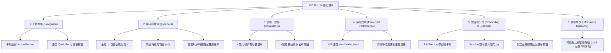

# Yahoo Fantasy LINE Bot UX 與互動流程全面優化提案書

## 1. 背景與現況概述

目前系統已成功實現多聯盟物理隔離架構、白名單安全機制、極簡白底 Flex 卡片與 LLM 自然語言意圖路由。然而，在日常群組互動與行動裝置使用場景下，仍存在若干影響流暢度與滿意度的體驗痛點。

本提案針對**操作斷點（死胡同）**、**手機端輸入容錯**、**指令回饋一致性**、**等待心理感知**、**管理引導**以及**球賽資訊呈現**進行系統性的梳理與優化規劃。

---

## 2. 六大 UX 優化維度分析

---

### 一、 互動閉環（Closed-Loop Navigation）：消除「死胡同」

#### 痛點
- 用戶查詢單項數據後流程即中斷（例如查完 `#對戰 肥儒` 後，若想看詳細數據或對手數據，必須重新喚起手機鍵盤手動輸入文字）。

#### 優化方案
1. **卡片底部附帶快捷行動按鈕（Action Footer）**：
   - **對戰比分卡**：加入 `[🙋‍♂️ 我的數據]`、`[🙋‍♂️ 對手數據]`、`[🏥 傷兵查詢]`。
   - **玩家數據卡**：加入 `[⚔️ 本週對戰]`、`[🏥 傷兵名單]`、`[📋 玩家選單]`。
   - **傷兵名單卡**：加入 `[🙋‍♂️ 查看數據]`、`[📋 玩家選單]`。
2. **LINE 原生 Quick Reply（快捷回覆膠囊）**：
   - 在所有回覆訊息中掛載 Quick Reply 膠囊標籤（如：`🏆 今日戰績`、`⚔️ 即時對決`、`🙋‍♂️ 玩家列表`、`🏥 傷兵查詢`）。
   - **優點**：浮動於手機鍵盤上方，不佔用群組聊天室訊息高度，單手一鍵觸發下一動作。

---

### 二、 指令容錯與輸入寬容度（Input Ergonomics）

#### 痛點
1. **全形符號誤判**：手機中文注音/拼音輸入法經常自動輸入全形 `＃`（如 `＃戰績`），系統因 `user_text.startswith("#")` 判定失敗而直接無視或交給 LLM 處理。
2. **嚴格空格要求**：多數正則使用 `\s+`，導致用戶連打（如 `#玩家大谷`、`#對戰阿明`、`#球員Curry`）無法觸發 Handler。
3. **查無玩家時的靜默處理**：打錯暱稱時 Handler 直接 `return` 靜默退出，用戶無法得知是機器人異常還是字打錯。

#### 優化方案
1. **符號自動正規化**：在訊息進入 Router 最前緣，將開頭的全形 `＃` 自動替換為半形 `#`。
2. **放寬空格限制**：正則改用 `\s*`，相容無空格連打。
3. **友善防呆引導**：查無該暱稱時，主動回覆：「⚠️ 找不到玩家『某某』，目前聯盟的玩家名單如下：」，並彈出玩家選擇按鈕。

---

### 三、 功能一致性（Consistency）

#### 痛點
- `#玩家` 與 `#對戰` 在不帶參數時會回傳點選選單；但 `#傷兵` 不帶參數時卻在後台直接略過，群組完全**已讀不回**。
- `#幫助` 的 Carousel 輪播選單卡片 2（`card_2_players.json`）只有「即時對決」和「玩家數據」，完全遺漏了 README 中列為核心功能的「傷兵名單」。

#### 優化方案
1. 當用戶單獨輸入 `#傷兵` 時，呼叫 `reply_player_list(mode="injury")`，彈出玩家列表點選卡片。
2. 在 `card_2_players.json` 中補入 `[🏥 傷兵名單]` 按鈕（發送 `#傷兵`）。

---

### 四、 感知效能與等待體驗（Perceived Performance）

#### 痛點
- Yahoo API 請求、Playwright 網頁渲染截圖（`#戰績`）、LLM 意圖辨識平均耗時 2 ~ 5 秒。
- 等待期間聊天室無任何反應，用戶易產生「沒收到」的疑慮而重複敲指令，造成伺服器重複工作與訊息洗版。

#### 優化方案
- **串接 LINE 原生 Loading 動畫 API (`chat/loading/start`)**：
  - 在進入耗時任務（截圖、API 爬取、LLM 路由）前送出 Loading 動畫。
  - 手機端對話框頂部會立即顯示「... 正在處理」，用戶瞬間感知機器人已接收請求，訊息回傳後自動消失。

---

### 五、 管理與設定會話（Session Flow & Onboarding）

#### 痛點
1. **入群無感知**：Bot 加入群組時未監聽 `JoinEvent`，完全靜默，群員不知如何開始。
2. **Session 缺乏取消機制引導**：進入改名或設定時間會話時，只提示「請在 60 秒內輸入」，未說明取消方式。
3. **設定後中斷**：設定成功後僅回應文字「✅ 成功設定...」，管理員若需進行下一項設定必須重新手動輸入 `#設置`。

#### 優化方案
1. **入群迎賓引導**：新增 `JoinEvent` 處理器，進群時自動推送 Welcome 卡片（管理員指引點擊 `[設置聯盟ID]`，成員指引點擊 `[#幫助]`）。
2. **Session 友善指引**：提示文案明確加上「（隨時輸入 `#` 可取消設置）」。
3. **連續設定體驗**：設定成功的訊息下方附帶 `[返回設置選單]` 按鈕，實現一氣呵成的後台配置。

---

### 六、 資訊視覺層次與球賽情境化（Information Hierarchy）

#### 痛點
- 跨時區（美西/美東 vs 台灣）導致用戶查詢時常困惑「比賽是否已結束？」、「這是即時累積還是昨天的？」。

#### 優化方案
- 在球員與對戰數據卡片上方標記賽況狀態：
  - 🔴 **LIVE 比賽進行中**
  - 🏁 **比賽已結束**
  - ⏰ **今日賽事尚未開打**

---

## 3. 實施路線圖與優先級矩陣

| 優先級 | 改善項目 | 核心改動模組 | 預期改善效益 | 實施成本 |
| :--- | :--- | :--- | :--- | :--- |
| **P0 (必修)** | **`#傷兵` 無參數選單與幫助選單補齊** | `injury_handler.py` `base_handler.py` `card_2_players.json` | 消除已讀不回，保持三大主指令行為一致 | 極低 (~0.5h) |
| **P0 (防呆)** | **輸入容錯（全形 `＃` 相容、無空格支援、查無暱稱防呆）** | `intent_router.py` `player_handler.py` `user_stats_handler.py` `matchup_handler.py` | 解決手機輸入法切換挫折，提供清晰引導 | 低 (~1h) |
| **P1 (關鍵體驗)** | **卡片底部 Action Buttons & Quick Reply** | `flex_builder.py` `base_handler.py` | 打造閉環互動，大幅減少用戶重開鍵盤打字頻率 | 中 (~2h) |
| **P1 (流暢感)** | **串接 LINE 原生 Loading 動畫 API** | `bot.py` `intent_router.py` `base_handler.py` | 消除 3~5 秒等待焦慮，徹底杜絕指令重複發送 | 低 (~1h) |
| **P2 (管理擴展)** | **入群迎賓（JoinEvent）與 Session 連續流程** | `bot.py` `session_manager.py` `settings_handler.py` | 降低新群組上線配置門檻，提升管理員配置效率 | 中 (~2h) |
| **P2 (數據豐富)** | **賽況狀態燈號標註 (LIVE / 完賽)** | `processor.py` `flex_builder.py` | 消除時差困惑，提升數據卡片的即時專業感 | 中 (~2h) |
